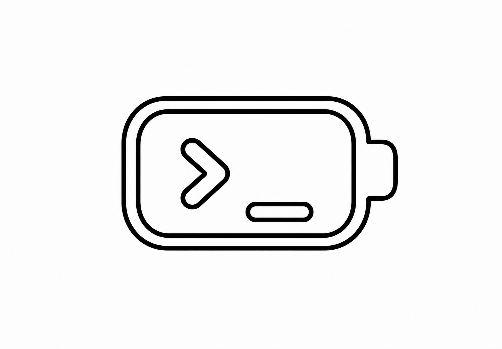

<p align="center">
  
</p>

<h1 align="center">Codex Usage Bar</h1>

<p align="center"><strong>Codex limits, a glance away.</strong><br>
A compact macOS menu bar battery for locally recorded 5h / 7d limits.<br>
用菜单栏电池查看本地记录的 Codex 剩余额度。</p>

<p align="center">
  <a href="https://github.com/xiangyixuan-k/codex-usage-bar/releases/latest"><strong>Download / 下载</strong></a> ·
  <a href="#install">Install</a> ·
  <a href="#安装">安装</a> ·
  <a href="#troubleshooting">Troubleshooting</a> ·
  <a href="#排障">排障</a>
</p>

<p align="center"><sub>macOS 13+ · English / 简体中文 · Local data · <a href="LICENSE">MIT</a></sub></p>

<p align="center"><a href="#english">English</a> · <a href="#中文">中文</a> · <a href="https://github.com/xiangyixuan-k/codex-usage-bar/issues">Feedback / 反馈</a></p>

> Check the source as well as the percentage: a local token estimate is not your account quota. **100% with no records does not establish full quota.** 先看来源再看百分比；无记录时的 100% 不代表真实满额。

## English

Codex Usage Bar is a small macOS menu bar app that shows your Codex remaining rate-limit percentage as an Apple-style battery icon.

It is designed to be boringly simple:

- Shows a compact battery in the macOS menu bar
- Reads Codex local response-header limits first
- Lets you choose whether the battery shows the 5h window, the 7d window, or the lower remaining value
- Falls back to model-matched session `rate_limits`
- Falls back again to local token estimation only when live limits are unavailable
- Never uploads usage data anywhere
- Does not read or upload `~/.codex/auth.json`

### Where the number comes from

| Priority | Source | What it represents |
| --- | --- | --- |
| 1 | Local request logs with `x-codex-primary-used-percent` / `x-codex-secondary-used-percent` | A recorded response-header snapshot |
| 2 | Model-matched session `rate_limits` | A recorded session snapshot |
| 3 | SQLite token totals, then JSONL usage | An estimate against your configured `tokenBudget` |

The app checks snapshot age and model matching before selecting a record. These checks reduce the risk of using a Spark snapshot for a different model; they cannot guarantee that a fresh, compatible record exists. A normal Codex login and a completed request can provide the local logs, but sign-in alone does not guarantee a usable reading.

### Install

1. Download the [v0.4.0 DMG](https://github.com/xiangyixuan-k/codex-usage-bar/releases/download/v0.4.0/CodexUsageBar-0.4.0.dmg) or [ZIP](https://github.com/xiangyixuan-k/codex-usage-bar/releases/download/v0.4.0/CodexUsageBar-0.4.0.zip).
2. Open the DMG or extract the ZIP, then copy `Codex Usage Bar.app` to Applications and open it.
3. Click the battery in the menu bar. In **Settings**, choose English or Simplified Chinese and the window to display.

Requires macOS 13 or later. If macOS blocks first launch, verify the download source and follow its Privacy & Security prompts.

Use Codex normally on this Mac; the app reads existing local records and does not request your login token. If no live snapshot appears, follow [Troubleshooting](#troubleshooting).

Or build from source with Swift 6.0 or later and Xcode Command Line Tools:

```bash
git clone https://github.com/xiangyixuan-k/codex-usage-bar.git
cd codex-usage-bar
./scripts/package-app.sh
open "dist/Codex Usage Bar.app"
```

### Menu

The menu includes:

- Remaining percentage
- 5h and 7d windows when Codex provides both
- `Menu Bar Shows` selector:
  - `5h remaining`
  - `7d remaining`
  - `Lower of 5h / 7d`

- `Settings` window:
  - Language: English / Simplified Chinese
  - Menu bar display mode

- Refresh now
- Open settings file from Settings
- Open Codex
- Quit

### Configure

On first launch, the app creates:

```text
~/.codex-usage-bar/config.json
```

Example:

```json
{
  "codexHome" : "~/.codex",
  "criticalRemainingPercent" : 10,
  "customStateDatabasePaths" : [],
  "enableOfficialRateLimitSnapshots" : true,
  "includeArchivedSessionsFallback" : false,
  "language" : "english",
  "maxRateLimitSnapshotAgeMinutes" : 360,
  "period" : "monthly",
  "rateLimitDisplayWindow" : "mostConstrained",
  "refreshIntervalSeconds" : 30,
  "tokenBudget" : 300000000,
  "warningRemainingPercent" : 25
}
```

When `enableOfficialRateLimitSnapshots` is true, the menu bar uses Codex's local response-header limits first:

- `primary` is the shorter rate-limit window
- `secondary` is the longer rate-limit window
- `mostConstrained` shows whichever window has less remaining percentage

The `tokenBudget` setting is only used by the final local token estimator.

### CLI Snapshot

You can test the parser without opening the menu bar UI:

```bash
swift run CodexUsageBar --once
swift run CodexUsageBar --once --json
swift run CodexUsageBar --once --budget 2000000 --period monthly
```

### Privacy

The app reads local files under your configured Codex home. It parses Codex request headers from local logs, parses session lines that contain `rate_limits` as a fallback, queries token totals from the local SQLite state database only when needed, and never uploads any of that data.

It does not read `~/.codex/auth.json`.

### Development

```bash
./scripts/smoke-test.sh
swift build
./scripts/package-app.sh
```

The package script builds:

- `dist/CodexUsageBar-<version>.dmg`
- `dist/CodexUsageBar-<version>.zip`

### Limitations

- Live limits update when Codex writes a completed request log.
- If the value looks stale, refresh after completing a Codex request you already intended to make; a usable local log is still required.
- The fallback local token estimate is not an official OpenAI quota meter.
- If Codex changes its local storage format, the app may need a parser update.

### Troubleshooting

#### The number is stale or suddenly shows 100%. What should I check?

Open the menu and check **Source** and warnings before relying on the percentage.

- `Codex response headers:` means a locally recorded request-header snapshot.
- `Codex session rate_limits:` means a fallback snapshot from a local session.
- **Live Codex limit not found yet** means no usable quota snapshot was found; the displayed value may be a local token-budget estimate.
- `source: none` or `No Codex usage records were found` means no records were found for the selected accounting period. Even a displayed 100% does not establish that your account has full quota or that a reset occurred.

Token estimation compares records the app can find with your configured `tokenBudget`. It is not an official quota and may not include activity on other devices.

#### Why does Updated change while the percentage stays the same?

**Updated** is the time of the app's read, not the timestamp of the quota record. The default refresh interval is 30 seconds; the default maximum snapshot age is 360 minutes. A fresh read can therefore still display an older snapshot. Stale or model-mismatched records can cause a fallback.

1. Compare the same model and window. **Lower of 5h / 7d** uses the lower remaining percentage among available windows.
2. After completing a Codex request you already intended to make, select **Refresh Now**. Recovery still depends on log availability and format compatibility; avoid repeated requests solely to refresh the display.
3. In **Settings → Open Settings File**, check that `codexHome` points to the local directory in use and `enableOfficialRateLimitSnapshots` is true. Do not blindly extend snapshot age just to retain an old number.
4. If the problem continues, retain the source, warnings, app version and macOS version. Increasing `tokenBudget` does not increase your actual quota.

#### How can I report the problem safely?

If you already have a source-build environment, run the existing command from the repository:

```sh
swift run CodexUsageBar --once --json
```
Inspect `source`, `warnings`, `updatedAt`, and, when present, `officialRateLimit.observedAt`. Do not confuse the read time with the quota observation time.

Share only versions, the selected model/window, the symptom and relevant redacted fields. Remove usernames, full local paths and session filenames. Do not upload your Codex directory, raw logs, conversation contents or `auth.json`. Tokens and passwords are not needed.

---

## 中文

Codex Usage Bar 是一个很小的 macOS 菜单栏工具，用电池图标显示 Codex 的剩余额度百分比。

它的设计目标是足够直观：

- 在 macOS 菜单栏显示一个短电池图标
- 优先读取 Codex 本地请求响应头里的真实额度
- 可以选择菜单栏电池显示 5 小时窗口、7 天窗口，或者二者中更低的剩余额度
- 如果没有实时响应头，再使用和当前模型匹配的 session `rate_limits`
- 最后才退回本地 token 估算
- 不上传任何使用数据
- 不读取、不上传 `~/.codex/auth.json`

### 数字来自哪里

| 优先级 | 来源 | 含义 |
| --- | --- | --- |
| 1 | 本地请求日志里的 `x-codex-primary-used-percent` / `x-codex-secondary-used-percent` | 已记录的响应头额度快照 |
| 2 | 与当前模型匹配的 session `rate_limits` | 已记录的会话额度快照 |
| 3 | SQLite token 总量，再尝试 JSONL 使用记录 | 相对于自行配置 `tokenBudget` 的估算 |

应用会检查快照年龄和模型匹配，减少把 Spark 快照用于其他模型的风险；这些检查不能保证一定存在新鲜且兼容的记录。正常登录并完成一次 Codex 请求可能提供本地日志，但仅登录不能保证读数可用。

### 安装

1. 下载 [v0.4.0 DMG](https://github.com/xiangyixuan-k/codex-usage-bar/releases/download/v0.4.0/CodexUsageBar-0.4.0.dmg) 或 [ZIP](https://github.com/xiangyixuan-k/codex-usage-bar/releases/download/v0.4.0/CodexUsageBar-0.4.0.zip)。
2. 打开 DMG 或解压 ZIP，将 `Codex Usage Bar.app` 拖入“应用程序”并打开。
3. 点击菜单栏电池，在“设置”中选择语言及显示窗口。

要求 macOS 13 或更新版本。如果系统阻止首次打开，请核对下载来源，再按“隐私与安全性”的系统提示操作。

在这台 Mac 上正常使用 Codex 即可让应用读取已有本地记录，不需要向它提供登录令牌。没有实时快照时，参见[排障](#排障)。

也可以安装 Swift 6.0 或更新版本及 Xcode Command Line Tools 后从源码构建：

```bash
git clone https://github.com/xiangyixuan-k/codex-usage-bar.git
cd codex-usage-bar
./scripts/package-app.sh
open "dist/Codex Usage Bar.app"
```

### 菜单

菜单里包含：

- 剩余额度百分比
- Codex 提供时显示 5 小时和 7 天两个窗口
- `Menu Bar Shows` 显示选项：
  - `5h remaining`
  - `7d remaining`
  - `Lower of 5h / 7d`

- `Settings / 设置` 窗口：
  - 语言：English / 简体中文
  - 菜单栏显示模式

- 立即刷新
- 在设置中打开配置文件
- 打开 Codex
- 退出

### 配置

首次启动后会创建：

```text
~/.codex-usage-bar/config.json
```

示例：

```json
{
  "codexHome" : "~/.codex",
  "criticalRemainingPercent" : 10,
  "customStateDatabasePaths" : [],
  "enableOfficialRateLimitSnapshots" : true,
  "includeArchivedSessionsFallback" : false,
  "language" : "english",
  "maxRateLimitSnapshotAgeMinutes" : 360,
  "period" : "monthly",
  "rateLimitDisplayWindow" : "mostConstrained",
  "refreshIntervalSeconds" : 30,
  "tokenBudget" : 300000000,
  "warningRemainingPercent" : 25
}
```

当 `enableOfficialRateLimitSnapshots` 为 true 时，菜单栏优先使用 Codex 本地响应头额度：

- `primary` 是较短的限额窗口
- `secondary` 是较长的限额窗口
- `mostConstrained` 显示剩余额度更低的窗口

`tokenBudget` 只在最终的本地 token 估算兜底里使用。

### 命令行快照

不打开菜单栏 UI，也可以测试解析结果：

```bash
swift run CodexUsageBar --once
swift run CodexUsageBar --once --json
swift run CodexUsageBar --once --budget 2000000 --period monthly
```

### 隐私

这个 app 只读取你配置的 Codex 本地目录。它会解析本地日志里的 Codex 响应头，把 session 中包含 `rate_limits` 的行作为后备，只在需要时查询本地 SQLite 里的 token 总量，并且不会上传这些数据。

它不会读取 `~/.codex/auth.json`。

### 开发

```bash
./scripts/smoke-test.sh
swift build
./scripts/package-app.sh
```

打包脚本会生成：

- `dist/CodexUsageBar-<version>.dmg`
- `dist/CodexUsageBar-<version>.zip`

### 限制

- 实时额度会在 Codex 写入完成请求日志后更新。
- 如果数字看起来滞后，完成一次原本需要的 Codex 请求后手动刷新；仍取决于本地日志是否存在且可解析。
- 本地 token 估算不是官方 OpenAI 配额表。
- 如果 Codex 以后修改本地存储格式，这个 app 可能需要更新解析器。

### 排障

#### 数字不更新、突然变成 100%，先看哪里？

打开菜单，先查看“来源”和警告，再看百分比。

- 来源以 `Codex response headers:` 开头：来自本地请求日志里的额度快照。
- 来源以 `Codex session rate_limits:` 开头：来自本地会话中的后备额度快照。
- 菜单提示“还没有找到 Codex 实时额度”：当前没有可用的额度快照，显示的可能是本地 token 预算估算。
- 来源为 `none`，或警告包含 `No Codex usage records were found`：未找到当前统计周期的记录。此时即使显示 100%，也不能据此判断账户余额或额度已重置。

本地 token 估算只反映应用找到的记录与自行设置的 `tokenBudget`，不是官方配额，也不能完整反映其他设备上的使用。

#### “更新”时间很新，为什么数字还是旧的？

菜单中的“更新”是应用本次读取的时间，不是额度日志的产生时间。默认每 30 秒刷新，允许额度快照的最大年龄默认为 360 分钟；因此新刷新可能仍使用较早的快照。过期或模型不匹配的记录可能触发后备读取。

按以下顺序排查：

1. 确认比较的是同一模型和同一额度窗口；“5 小时 / 7 天中更低值”显示可用窗口中更低的剩余百分比。
2. 完成你本来需要的一次 Codex 请求后，点“立即刷新”。这不保证必然恢复，仍取决于日志是否写入及格式是否兼容；无需为了刷新反复发无意义请求。
3. 在“设置 → 打开设置文件”中核对 `codexHome` 是否对应正在使用的本地目录，以及 `enableOfficialRateLimitSnapshots` 是否为 true。不要为了让旧数字继续显示而盲目增加快照时限。
4. 如果仍无数据，保留来源、警告、应用版本和系统版本供排查。单纯提高 `tokenBudget` 不会增加真实额度。

#### 如何提供有用且安全的反馈？

如已具备源码构建环境，可在仓库目录运行已有命令：

```sh
swift run CodexUsageBar --once --json
```
该输出可帮助核对 `source`、`warnings`、`updatedAt`，以及存在时的 `officialRateLimit.observedAt`。不要把 `updatedAt` 当作额度快照时间。

反馈只需说明版本、所选模型/窗口、现象和经过脱敏的相关字段。提交前删除用户名、完整本地路径、会话文件名等个人信息。不要上传完整 Codex 目录、原始日志、会话正文或 `auth.json`；无需提供令牌或密码。
